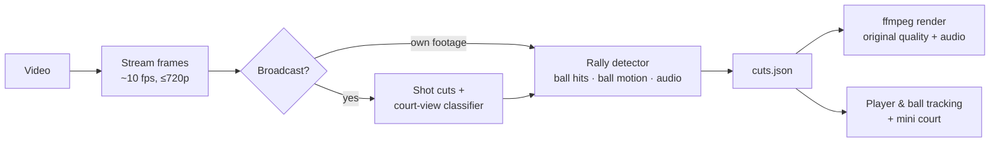

# 🎾 Tennis Analysis

Automatically cut tennis footage down to the live rallies, then track the players and ball on a top-down mini court.

It works on broadcast highlight reels, full broadcast matches, and your own single-camera recordings.

---

## What it does

**1. Rally editor**: drops everything that isn't a point being played:

- closeups, replays, crowd shots and graphics
- players walking, toweling off or bouncing the ball before a serve

It writes the kept segments to an editable cut list and renders them straight from the original file, at full resolution and with audio.

**2. Tracking & mini court**: on the rally segments, it:

- detects the two players and the ball
- maps the court with 14 keypoints
- projects everything onto a 2D mini court using a homography

## How it works



| Stage | Approach |
|---|---|
| **Shot cuts** | HSV histogram jumps between frames |
| **Court view gate** | MobileNetV3 features plus a linear classifier, trained on your own labeled frames; majority vote per shot |
| **Rally detection** | YOLOv8 ball detections → direction reversals (hits) and sustained motion, plus band-passed audio impacts, grouped into rallies with pre/post roll |
| **Player selection** | Foot positions mapped to court meters; one player per side, scored by position, depth and expected body height, with frame-to-frame continuity |
| **Court mapping** | ResNet50 keypoint regressor, predicted per frame and median-smoothed within each segment |

## Quick start

### Requirements

- Python 3.11
- `ffmpeg` on your PATH (`brew install ffmpeg`)
- Apple Silicon (MPS) is used automatically; CPU works too

```bash
python -m venv .venv && source .venv/bin/activate
pip install -r requirements.txt
```

### Models

Weights aren't checked in. Put them in `models/`:

| File | What | Source |
|---|---|---|
| `yolo8_best.pt` | Tennis ball detector | `training/tennis_ball_detector_training.ipynb` |
| `keypoints_model.pth` | Court keypoint regressor | `training/tennis_court_keypoints_training.ipynb` |
| `view_classifier.pt` | Court-view gate (broadcast only) | `scripts/train_view_classifier.py`, see below |

The player detector (`yolov8l`) downloads automatically through Ultralytics.

## Usage

### Cut a video down to rallies

```bash
# Broadcast footage (highlights or full matches)
python -m editor.cli input_videos/match.mp4

# Your own single-camera recording (skips the view gate)
python -m editor.cli my_match.mp4 --source own

# Only write the cut list, don't render
python -m editor.cli match.mp4 --cuts-only
```

Outputs:

- `output_videos/<name>_cuts.json`: rally segments with start, end and confidence. Edit by hand if you like.
- `output_videos/<name>_rallies.mp4`: the rendered edit.

Analysis is cached in `editor_cache/`, so tweaking the rally thresholds and re-running is instant. Use `--refresh` to force a new analysis.

<details>
<summary>All options</summary>

| Flag | Default | |
|---|---|---|
| `--source` | `broadcast` | `broadcast` runs the view gate, `own` skips it |
| `--fps` | `10` | Analysis frame rate |
| `--max-height` | `720` | Analysis resolution |
| `--check-every` | `0.5` | Seconds between view-gate checks |
| `--no-audio` | off | Ignore the audio track |
| `--cuts-only` | off | Skip rendering |
| `--refresh` | off | Ignore cached analysis |
| `-o` | `output_videos/<name>_rallies.mp4` | Output path |

</details>

### Track players & ball

```bash
python main.py input_videos/match.mp4 --cuts output_videos/match_cuts.json
```

This writes `output_videos/output_video.avi` with player and ball boxes, court keypoints and the mini court. Add `--use-stubs` to reuse saved detections when re-running on the same video and cuts.

### Train the court-view gate

Broadcasts need a classifier that knows what "main camera" looks like. It takes about 5 minutes:

```bash
# 1. Dump frames to sort
python scripts/label_frames.py input_videos/*.mp4 --every 1.0

# 2. Move each image from labels/unsorted/ into labels/court_view/ or labels/other/

# 3. Train
python scripts/train_view_classifier.py
```

Label frames from several tournaments and court surfaces so it generalizes.

### Evaluate cuts

```bash
python scripts/eval_cuts.py output_videos/match_cuts.json labels/match_rallies.json
```

The ground truth is a JSON list of `[start_s, end_s]` rallies. The script reports recall, precision and median start/end error.

## Project structure

```
editor/               Rally editor: streaming analysis → cut list → render
  cli.py              Entry point
  shot_segmenter.py   Camera-cut detection
  view_gate.py        Court-view classifier (+ training)
  rally_detector.py   Ball/audio signals → rally segments
  audio_hits.py       Racket-impact onsets from the audio track
  court_keypoint_check.py  Homography sanity check
  export.py           cuts.json + ffmpeg render
trackers/             Player (YOLOv8l) and ball (custom YOLOv8) trackers
court_line_detector/  Court keypoint model
mini_court/           Top-down court drawing + homography projection
scripts/              Labeling, training and evaluation helpers
training/             Model training notebooks
utils/                Video I/O, bbox and unit helpers
constants/            Court dimensions (meters)
main.py               Tracking + mini-court pipeline
```

## Limitations

- The court-view classifier is only as general as its labels. Train it on footage similar to what you'll run it on.
- Player IDs are per side of the net (1 = far, 2 = near), not per person, so they swap at changeovers.
- Rally thresholds are tuned on a small number of broadcast clips. Audio detection and `--source own` are not yet validated.
- The tracking pipeline (`main.py`) holds the analyzed frames in memory, so it suits clips and rally segments rather than whole matches.

## Acknowledgements

Started from a tennis analysis tutorial, then extended with the rally editor, homography-based mini court and player selection.
